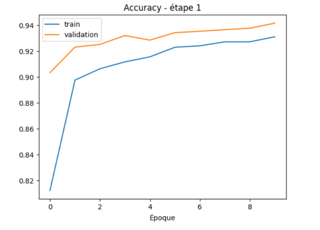
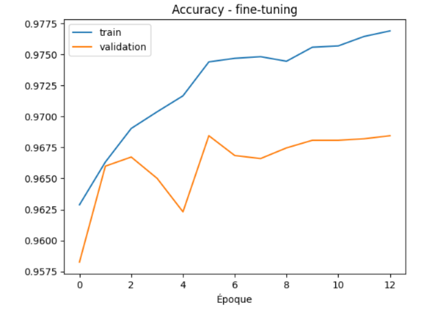
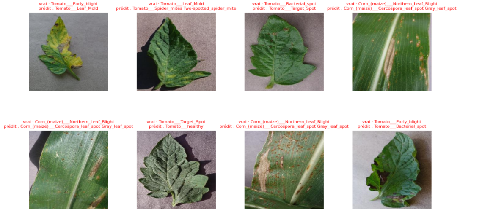

# PhytoScan — Classification des maladies des plantes

> **PhytoScan** est un projet de computer vision consacré à l'identification des maladies des plantes à partir d'images de feuilles. Il a été développé dans une démarche d'apprentissage et d'expérimentation, en comparant un CNN entraîné from scratch à une approche de transfer learning basée sur MobileNetV2. Les résultats, la méthodologie et les limites sont présentés de manière honnête et transparente. Have fun 😊

**Objectif :** identifier l'espèce et l'état sanitaire d'une plante à partir d'une photo de feuille, parmi **38 classes**, en comparant MobileNetV2 (transfer learning) à un CNN entraîné de zéro.

## Résultats

Mesurés sur un jeu de test de ~15 % du dataset PlantVillage (~54 000 images au total), tiré de la même distribution que l'entraînement.

| Modèle | Accuracy (test) | Macro F1 (test) |
|---|---:|---:|
| CNN from scratch | 84,18 % | 79,86 % |
| MobileNetV2 (transfer learning + fine-tuning) | **97,25 %** | **96,53 %** |

Le transfer learning gagne environ 13 points d'accuracy et 17 points de macro F1 sur le CNN entraîné de zéro. L'écart plus grand sur le macro F1 suggère que le CNN échoue surtout sur certaines classes.

Ces scores sont à lire avec les [limites](#limites-connues) ci-dessous : le test set vient du même dataset (photos de laboratoire) et une fuite entre train et test n'est pas exclue.

Le macro F1 est inférieur de 0,7 point à l'accuracy : quelques classes sont plus difficiles que les autres.

**Courbes d'entraînement**




**Matrice de confusion**


**Analyse des erreurs**



MobileNetV2 fait 224 erreurs sur 8 146 images de test (2,75 %). Les dix paires de classes les plus confondues représentent 95 de ces erreurs :

| Vraie classe | Classe prédite | Erreurs |
|---|---|---:|
| Tomato Spider mites (Two-spotted spider mite) | Tomato Target Spot | 19 |
| Corn Northern Leaf Blight | Corn Cercospora leaf spot / Gray leaf spot | 14 |
| Tomato Early blight | Tomato Target Spot | 12 |
| Tomato Early blight | Tomato Late blight | 10 |
| Tomato Late blight | Potato Late blight | 8 |
| Tomato Septoria leaf spot | Tomato Target Spot | 8 |
| Corn Cercospora leaf spot / Gray leaf spot | Corn Northern Leaf Blight | 7 |
| Tomato Target Spot | Tomato healthy | 6 |
| Tomato Bacterial spot | Tomato Target Spot | 6 |
| Tomato Bacterial spot | Tomato Septoria leaf spot | 5 |

Trois constats :

1. **La tomate concentre les erreurs** : 8 des 10 paires les plus fréquentes concernent des maladies de la tomate, et *Target Spot* est la mauvaise prédiction la plus fréquente (45 erreurs sur ces dix paires, pour quatre maladies différentes).
2. **Confusion dans les deux sens sur le maïs** : *Northern Leaf Blight* et *Cercospora / Gray leaf spot* sont confondues l'une avec l'autre (14 + 7 = 21 erreurs), ce qui suggère des symptômes visuellement proches.
3. **Une erreur d'espèce plus que de maladie** : 8 images de *Tomato Late blight* sont prédites *Potato Late blight*. Cette maladie touche les deux plantes, donc le modèle reconnaît probablement le symptôme mais se trompe d'espèce.

## Méthode

- **Données** : [PlantVillage](https://www.kaggle.com/datasets/abdallahalidev/plantvillage-dataset), dossier `color`, 38 classes, images redimensionnées en 224 × 224 RGB.
- **Découpage** : stratifié, 70 % train / 15 % validation / 15 % test, graine fixe (`seed = 42`).
- **Augmentation** (entraînement uniquement) : flips horizontal et vertical, rotation, zoom.
- **MobileNetV2** pré-entraîné sur ImageNet, en deux phases :
  1. *Feature extraction* : base gelée, nouvelle tête (`GlobalAveragePooling2D`, `Dropout(0.3)`, `Dense(38, softmax)`), learning rate `1e-3` ;
  2. *Fine-tuning* : 30 dernières couches dégelées (BatchNorm gardées gelées), learning rate `1e-5`.
- **CNN de référence** : 3 blocs `Conv2D` + `MaxPooling2D`, `GlobalAveragePooling2D`, `Dense(38, softmax)`, sans poids pré-entraînés.
- **Optimisation** : Adam, sparse categorical crossentropy, `EarlyStopping` et `ReduceLROnPlateau` sur la loss de validation.

Tous les paramètres (tailles, époques maximum, graine, `n_par_classe`) sont dans [`configs/config.yaml`](configs/config.yaml). Mettre `n_par_classe: 100` pour un essai rapide.

## Installation

Prérequis : Python 3.10 ou plus, un compte Kaggle (clé API dans `~/.kaggle/kaggle.json`, à ne jamais ajouter au dépôt).

```bash
git clone https://github.com/<ton-utilisateur>/PhytoScan.git
cd PhytoScan

python -m venv .venv
source .venv/bin/activate        # Windows PowerShell : .venv\Scripts\Activate.ps1
pip install -r requirements.txt

bash scripts/download_data.sh    # télécharge le dataset dans data/plantvillage
```

## Utilisation

```bash
python -m src.train                                        # MobileNetV2 + CNN (modèles dans models/)
python -m src.train --model transfer                       # MobileNetV2 seulement
python -m src.evaluate --cnn models/cnn_scratch.keras      # métriques, figures et comparaison dans reports/figures/
python -m src.predict chemin/vers/feuille.jpg              # 3 classes les plus probables avec leur probabilité
pytest                                                     # tests du découpage des données
```
<!-- TODO : coller ici une vraie sortie de `python -m src.predict ...` -->

Les modèles entraînés ne sont pas versionnés : il faut lancer `python -m src.train` avant `evaluate` et `predict`.

## Structure

```text
configs/    configuration de l'expérience
src/        config, data, model, train, evaluate, predict
notebooks/  exploration et analyse des erreurs
scripts/    téléchargement des données
tests/      tests du découpage des données
reports/    figures et métriques générées
```

## Limites connues

1. **Conditions du dataset** : PlantVillage contient surtout des feuilles isolées sur fond uniforme. Les performances ne garantissent pas les mêmes résultats sur des photos prises au champ.
2. **Fuite possible train/test** : le découpage est aléatoire par image et le dataset contient des variantes très proches d'une même feuille, ce qui peut gonfler les scores. Aucun contrôle de doublons n'a encore été fait.
3. **Pas de classe « inconnu »** : le modèle répond toujours par l'une des 38 classes, même pour une image qui n'est pas une feuille.
4. **Généralisation non évaluée** : aucun test sur des images d'autres sources ni sur des conditions réelles.

## Pistes d'amélioration

1. **Détecter les doublons et découper par groupes d'images similaires.**
2. **Evaluer sur des photos réelles.**
3. **Ajouter une détection d'images hors distribution.**
4. **essayer d'autres architectures pré-entraînées.**
5. **Proposer une interface de démonstration.**

## Auteur

Hazem BARKALLAH || [GitHub Profile](https://github.com/Hazem-Barkallah)

*Projet à visée pédagogique et expérimentale. Les prédictions ne remplacent pas un diagnostic professionnel.*
